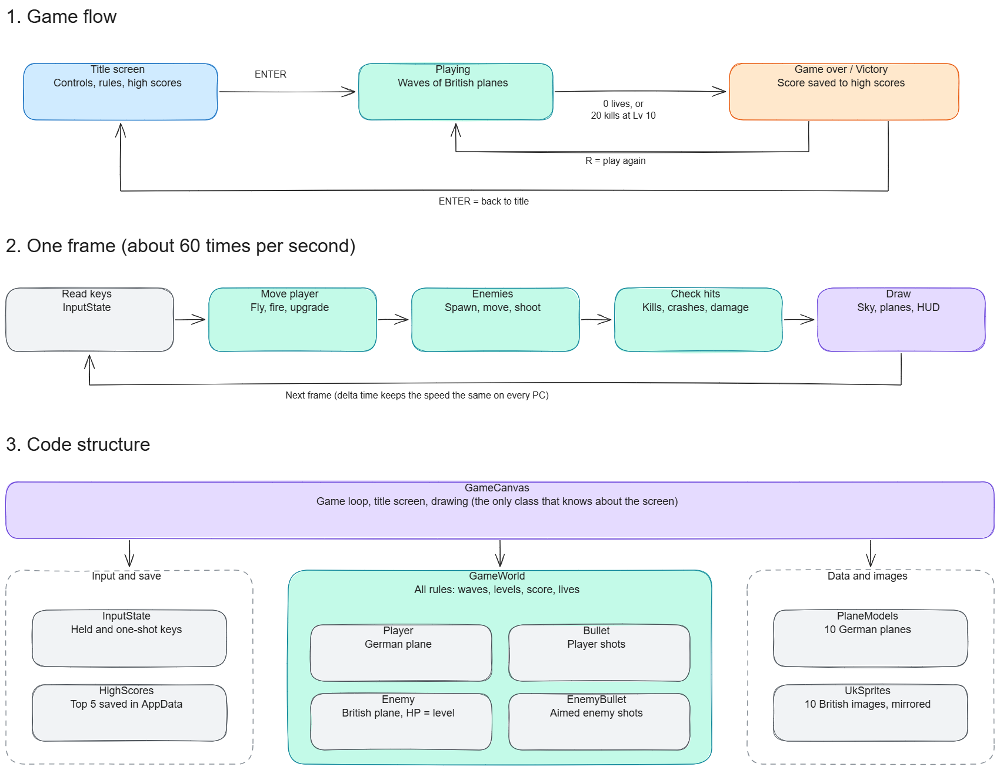

# Luftwaffe 1936–1945

A 2D side-scrolling arcade shooter built in C# with [Avalonia UI](https://avaloniaui.net/), inspired by classic arcade games like *1942*.

You fly for the Luftwaffe from 1936 to 1945. Shoot down British planes, earn better aircraft, and survive until you master the Me 262.

## Features

- Smooth 60 fps game loop with delta time
- 10 German planes to unlock, from Ju 52 to Me 262
- 10 British enemy planes, from Fairey Swordfish to Gloster Meteor
- Enemy waves that get stronger over time
- Enemies that shoot aimed bullets, and crashes that hurt
- HP bar, 3 lives and 5 seconds of protection after losing a life
- Scrolling sky background with parallax
- Title screen with controls, rules and high scores
- Top 5 high scores saved to file
- Virtual 640x360 resolution scaled to any window size

## Controls

| Key | Action |
|---|---|
| Arrows / WASD | Fly |
| Space (hold) | Fire |
| Enter | Start / back to title screen |
| R | Play again after game over |
| U | Upgrade plane (test key) |

## Rules

| Rule | Value |
|---|---|
| Damage per bullet | Player level |
| HP | Plane level (player and enemies) |
| Next German plane | Every 20 kills |
| Enemies get one level stronger | Every 15 planes |
| Shoot down a plane | +10 points |
| A plane escapes | −2 points (never below 0) |
| Victory | 20 kills with the Me 262 (level 10) |

## Planes

| Level | German (player) | British (enemy) |
|---|---|---|
| 1 | Ju 52 | Fairey Swordfish |
| 2 | Ju 87 Stuka | Hawker Hurricane |
| 3 | Ju 88 | Vickers Wellington |
| 4 | Bf 109 | Bristol Beaufighter |
| 5 | Fw 190 D-9 | Short Sunderland |
| 6 | He 219 Uhu | Avro Lancaster |
| 7 | Ta 152 | de Havilland Mosquito |
| 8 | Ar 234 | Supermarine Spitfire |
| 9 | Me 163 Komet | Hawker Tempest V |
| 10 | Me 262 | Gloster Meteor |

## Running the project

Requires the [.NET 10 SDK](https://dotnet.microsoft.com/download).

```bash
git clone https://github.com/ronhr0626/Luftwaffe1936-1945.git
cd Luftwaffe1936-1945
dotnet run
```

## Overview



## Structure

```
Assets/            Images (PNG)
  Germany/             10 German planes, facing right
  Uk/                  10 British planes, mirrored in code
  sky.png              Scrolling background
Game/              Game logic, no UI
  GameWorld.cs         All game rules: waves, hits, damage, score, levels, lives
  Player.cs            The player's plane
  PlaneModel.cs        Stats and sprites for the 10 German planes
  Bullet.cs            Player shots
  Enemy.cs             British planes: size, speed, HP and shooting
  EnemyBullet.cs       Aimed enemy shots
  UkSprites.cs         Loads and mirrors the British images
  InputState.cs        Which keys are held or just pressed
  HighScores.cs        Top 5 saved in AppData
  GameCanvas.cs        Game loop, title screen and all drawing
Excalidraw/        Diagrams (Excalidraw + PNG)
```

## What I learned

- **Custom rendering** with `DrawingContext` in Avalonia: images, shapes and text
- **Game loop** with `DispatcherTimer` and **delta time**, so speed is the same on every PC
- **Virtual resolution** (640x360) scaled to the window with transforms
- **Sprites**: keeping aspect ratio and **mirroring** with a transform matrix
- **Seamless scrolling background** without gaps between copies
- **Input handling**: held keys vs. one-shot presses
- **Collision detection** with rectangle overlap
- **Aiming**: enemy bullets use a direction vector towards the player
- **Game balance** with simple level rules for HP, damage and waves
- **Game states**: title screen, playing, game over and victory
- **File handling** for high scores in `AppData`
- **Separating logic from drawing**: `GameWorld` knows nothing about the screen

## Tech

- C# / .NET 10
- Avalonia 12